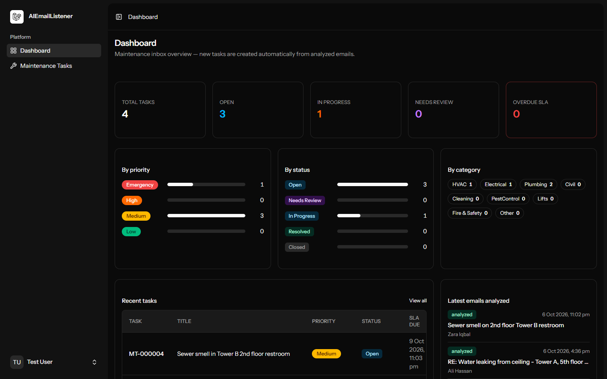
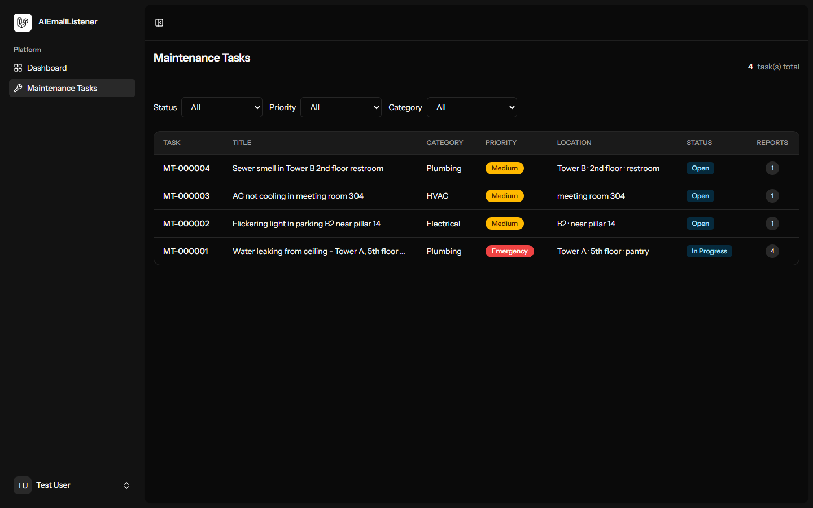
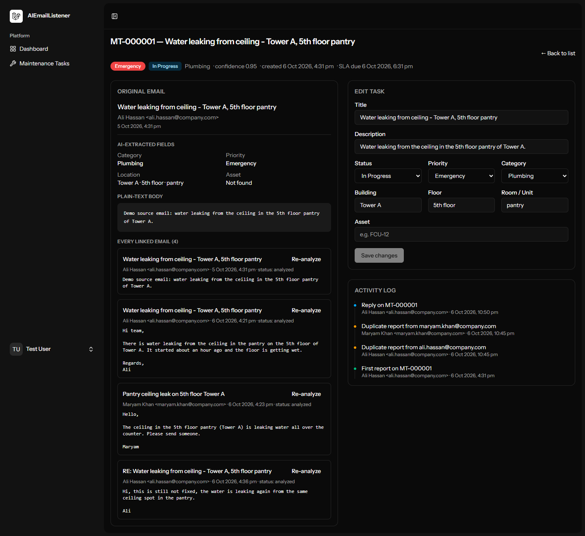

# AI Email Listener

A Laravel + Vue prototype that watches a mailbox, uses an LLM to decide whether each email is a
facility maintenance request, and — when it is — creates a structured maintenance task.

```
mailbox → emails:fetch (Artisan, every minute) → queued AnalyzeEmailJob
        → AI analysis (subject + body → JSON)   → TaskCreationService
        → task / duplicate / reply / ignored     → acknowledgement email
```

## Screenshots

| Dashboard | Tasks list |
| --- | --- |
|  |  |

| Task detail |
| --- |
|  |

## Stack

- PHP 8.3+, Laravel 13, SQLite, database queue, log mailer
- Vue 3 + Inertia + Vite (starter kit)
- Pest for tests

## Setup

```bash
composer install
npm install
cp .env.example .env          # adapt values below if needed
php artisan key:generate
npm run build                 # or `npm run dev`
php artisan migrate --seed
```

`.env` keys specific to this app:

| Key | Default | Purpose |
| --- | --- | --- |
| `MAILBOX_DRIVER` | `fake` | `fake` = seeded sample inbox, `imap` = real mailbox |
| `IMAP_HOST/PORT/USERNAME/PASSWORD` | – | used when `MAILBOX_DRIVER=imap` |
| `AI_PROVIDER` | `fake` | `fake` = offline rule-based analyzer, `openrouter` = LLM |
| `AI_MODEL` | `google/gemma-4-31b-it:free` | model served via OpenRouter |
| `OPENROUTER_API_KEY` | – | key from https://openrouter.ai/keys |
| `AI_CONFIDENCE_THRESHOLD` | `0.7` | below this, new tasks are created as `Needs Review` |

No credentials are committed; everything lives in `.env` (see `.env.example`).

## Run the pipeline

Three processes (or use `composer run dev` which starts server + queue + vite):

```bash
php artisan serve
php artisan queue:work
npm run dev
```

Then pick up the seeded sample emails (scheduler alternative: `php artisan schedule:work`):

```bash
php artisan emails:fetch      # pulls the fake inbox, dispatches 1 job per email
php artisan queue:work --once # let the AI (or fake analyzer) process them
```

The seeders insert a sample inbox (new task / duplicate / HVAC / electrical / ignore / reply)
plus one already-processed demo task, so the UI has content immediately:

- Task list → http://localhost:8000/tasks
- Task detail → click any task number

To test with a real AI, run `emails:fetch` and then `queue:work --once` with `AI_MODEL` /
`OPENROUTER_API_KEY` set:

```bash
php artisan emails:fetch
php artisan queue:work --once
```

## REST API

| Method | Endpoint | Purpose |
| --- | --- | --- |
| GET | `/api/tasks?status=&priority=&category=` | Paginated list, filterable |
| GET | `/api/tasks/{id}` | Task detail + source email + logs |
| PATCH | `/api/tasks/{id}` | Update status/priority/category/location/… |
| POST | `/api/emails/{id}/reprocess` | Re-run the AI analysis for an email |

## Tests

```bash
php artisan test
```

Coverage: AI response parsing and the emergency-priority rule, the OpenRouter client (HTTP
errors, code fences, invalid JSON), duplicate/complaint detection, reply threading, ignored
emails, low-confidence `Needs Review`, task creation + acknowledgement, the fetch command's
message-id dedup, and the REST endpoints. The AI call is always mocked or faked.

## Where each step lives

| Step | File / class |
| --- | --- |
| Fetchs new emails, dedup by `message_id`, dispatch | `app/Console/Commands/FetchEmailsCommand.php` |
| Decides maintenance, writes to logs + ack mail | `app/Services/TaskCreationService.php` |
| LLM call + JSON parsing + validation | `app/AI/OpenRouterAnalyzer.php`, `app/AI/AnalysisResult.php` |
| Prompt (single file) | `resources/prompts/maintenance-analysis.txt` |
| Mailbox abstraction | `app/Mailbox/MailboxClient.php` (+ `FakeMailbox`, `ImapMailbox`) |
| Queued analysis job (3 retries) | `app/Jobs/AnalyzeEmailJob.php` |
| Task list / detail pages | `resources/js/pages/tasks/Index.vue`, `Show.vue` |